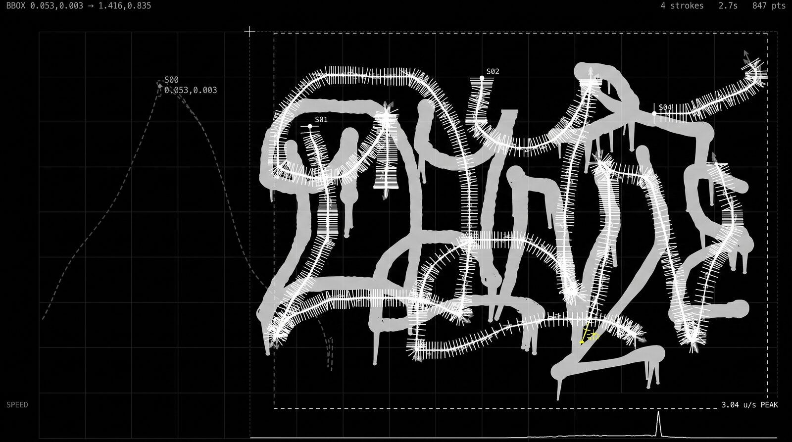

# 000000book

An open archive of motion-captured graffiti, running since 2009. Every tag is a
[GML](http://fffff.at/gml-week-graffiti-markup-language/) file: the writer's
hand as coordinates and timestamps, replayable by anyone. Writers capture and
share tags; programmers build things that read them. Live at
[000000book.com](https://000000book.com).

Rails 8.1 on Ruby 3.4, MySQL 8.4. Beta uses a Docker container managed by
Kamal; production still uses `./deploy`. Assets use Propshaft and plain ES modules,
with no Node build step.

## Run it

Install Ruby from `.ruby-version`, Bundler, Docker, MySQL client development
libraries and ImageMagick first. The app runs locally; Compose runs only MySQL.

```bash
docker compose up -d      # MySQL 8.4, the version the server runs
bundle install
bin/rails db:prepare
bin/rails db:seed         # optional: updates existing development records
bin/rails server          # http://localhost:3000
bundle exec rspec         # no environment variables needed
```

`MYSQL_PORT` and `MYSQL_PASSWORD` override `config/database.yml`.
Seeds need an existing user and do not create tags or import the archive.

`bin/setup --skip-server` installs dependencies without running migrations or
clearing logs. `bin/check` runs lint and tests without editing files.
Use `bin/format [files]` separately for safe RuboCop corrections.

## What is where

- `public/canvasplayer/<version>/` is [canvasplayer](https://github.com/jamiew/canvasplayer),
  byte for byte. `SOURCE` there says how to update. It lives outside the asset
  pipeline because Propshaft's fingerprints would break the modules' relative
  imports.
- `app/assets/javascripts/player.js`, `gml_thumbnails.js` and `recorder.js` are
  the only player code that belongs here: the tag page, the live grid cells,
  and the recorder on `/upload`.
- `data/<id>.gml` is each tag's file, read and written by `GmlObject`. Images
  are Active Storage on local disk.
- `docs/` is the API and GML documentation, served at
  [/docs](https://000000book.com/docs) and indexed by
  [/llms.txt](https://000000book.com/llms.txt). `/api` redirects to `/docs/api`;
  `/openapi.yaml` describes the API.

## Pages

- `/` plays a tag beside a curated grid. Click a cell, press ← →, or let it run
  like a slideshow. `/data` is the searchable grid with a display-mode dropdown.
  The front page keeps labels and controls quiet.
- `/data/:id` is one tag with a filmstrip of its neighbours. Controls opens the
  pane: looks, live or still, ink mode, effects, data layers.
- `/apps` plays the newest tag made with each app. `/upload` explains how to
  make a tag and lets you draw one.

## API

- `GET /data/:id.gml`, `.json` or `.xml`. JSON includes GML; XML is metadata only.
  JSON `?preview=1` is for thumbnails; `?player=1` is the site's playback payload.
- `POST /data` with `gml=` uploads. Details in [docs/api](docs/api/README.md).

## Migrations and data

Start with `bin/rails data:validate` (read-only; exits non-zero on blockers).
Rehearse pending migrations with `./script/rehearse-migrations.sh` before applying
them; it requires production SSH access. Tests use `schema.rb`, not the legacy
production schema.

Migrations never run automatically on deploy. The repository includes a migration
that drops `comments`; check the target's migration status and backup first.
Legacy `gml_objects:save_to_disk` and `gml_objects:fix_missing` tasks write files.
`tags:delete_missing_data` destroys rows and requires
`CONFIRM_DELETE=yes-i-have-a-backup`. See [operations](docs/operations.md) before
running maintenance.

## Deploy

See [deployment](docs/deployment.md) for beta's Kamal setup and the legacy
production deploy, and [operations](docs/operations.md) for backups, audits,
resync and migration rehearsal.

## Team

[Jamie Wilkinson](http://jamiedubs.com), [Evan Roth](http://evan-roth.com),
[Theodore Watson](http://www.theowatson.com), [Chris Sugrue](http://csugrue.com/)
and [Todd Vanderlin](http://toddvanderlin.com/) of the copyleft
[F.A.T. Lab](http://fffff.at), with Flash help from
[Manolis Perrakis](http://art.manorius.com/). Contact info[at]000000book.com.
MIT licensed. Copyfree 2009 onward. "Release early, often & w/ rap music."
